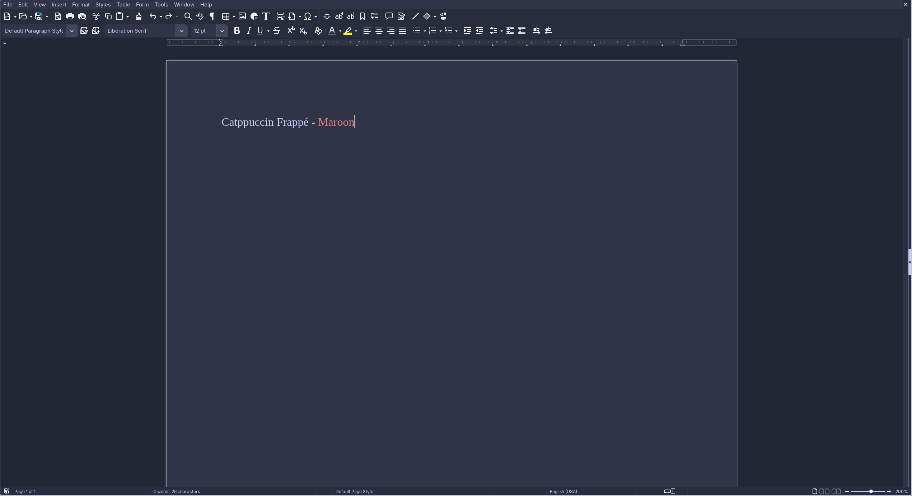
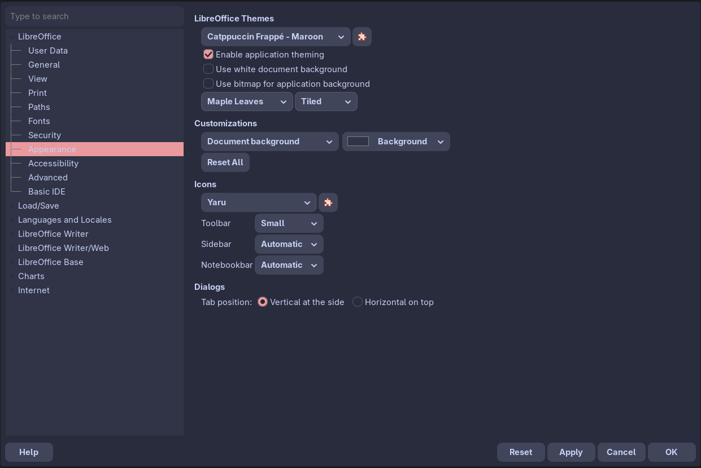
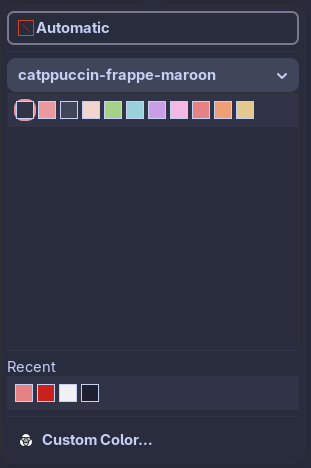

# Catppuccin for LibreOffice (unofficial, full UI theme)

Four Catppuccin-flavoured **LibreOffice theme extensions** (`.oxt`) that theme
the whole application: menus, toolbars, buttons, dialogs and document colors.

> **Unofficial.** This is an independent project. It is **not affiliated with or
> endorsed by** the Catppuccin project or the maintainers of
> [`catppuccin/libreoffice`](https://github.com/catppuccin/libreoffice). It builds
> on the MIT-licensed [Catppuccin palette](https://github.com/catppuccin/palette).

## How is this different?

The existing `catppuccin/libreoffice` project ships a *document color* scheme:
it recolors grid lines, page boundaries, syntax highlighting and the document
background, but **not** the window **chrome** (toolbars, sidebar, buttons, menus).

This project builds a full LibreOffice **UI ColorScheme** extension that paints
the chrome too. Colour values and document/editor node names are kept compatible with
the official Catppuccin LibreOffice project for visual consistency.

## Available themes

Four flavors, each shipped as one `catppuccin-<flavor>.oxt` that bundles **all 14
Catppuccin accents**. Installing an extension does **not** change your active
scheme; open **Tools › Options › LibreOffice › Appearance** and pick any
`Catppuccin <Flavor> - <Accent>` scheme (e.g. `Catppuccin Mocha - Mauve`).

| Flavor | Schemes inside the `.oxt` | Type |
| --- | --- | --- |
| Mocha | `Catppuccin Mocha - <Accent>` × 14 | dark |
| Macchiato | `Catppuccin Macchiato - <Accent>` × 14 | dark |
| Frappé | `Catppuccin Frappé - <Accent>` × 14 | dark |
| Latte | `Catppuccin Latte - <Accent>` × 14 | light |

<details>
<summary>Preview - Frappé Maroon</summary>







</details>

## Install

### GUI

1. Download or build `catppuccin-<flavor>.oxt`. (Available on the [release page](https://github.com/Alex98235/libreoffice-catppuccin-theme/releases)).
2. LibreOffice → **Tools › Extensions… › Add…** → pick the `.oxt` file.
3. Restart LibreOffice → **Tools › Options › LibreOffice › Appearance** and
   choose the `Catppuccin …` color scheme.

### Command line

Close LibreOffice first. Download `catppuccin-<flavor>.oxt` from the
[release page](https://github.com/Alex98235/libreoffice-catppuccin-theme/releases)
or build it yourself (see below), then install with `unopkg`:

```bash
unopkg add -f catppuccin-mocha.oxt
```

By installing you accept the MIT licence (see [`LICENSE`](LICENSE)).

## Building

Requires Python 3.

```bash
python3 scripts/build.py                 # 4 flavors, all accents in each -> dist/
python3 scripts/build.py --flavor mocha  # one flavor, all accents in one .oxt
python3 scripts/build.py --flavor frappe --accent teal   # a single-accent .oxt
python3 scripts/build.py --all-accents   # one .oxt per flavor/accent combination
```

Options: `--out DIR`. Output goes to `dist/` (git-ignored).

Accent tokens: `rosewater flamingo pink mauve red maroon peach yellow green teal
sky sapphire blue lavender`.

## Uninstall

```bash
unopkg list | grep -i catppuccin          # find the identifier
unopkg remove io.github.alex98235.libreoffice.catppuccin.mocha # (example)
```

Combined extensions use a flavor-level id (`…catppuccin.<flavor>`); single-accent
builds add the accent (`…catppuccin.<flavor>.<accent>`).

## How it works

Each `.oxt` contains:

- `Theme_Colors.xcu`: a `org.openoffice.Office.UI/ColorScheme` component
  defining window chrome + document/editor color nodes. A combined file declares
  one scheme per accent (`Catppuccin <Flavor> - <Accent>`).
- `Paths.xcu`: registers the bundled `.soc` palette folder.
- `palettes/catppuccin-<flavor>-<accent>.soc`: matching color-picker palette
  (one per accent).
- `description.xml`, `META-INF/manifest.xml`, licence and icon.

Colors are stored as 24-bit decimal integers (`int(hex, 16)`) per node, which is
what LibreOffice expects for `Color` properties.

## Licence

MIT. See [LICENSE](LICENSE). Catppuccin palette © Catppuccin contributors (MIT).
